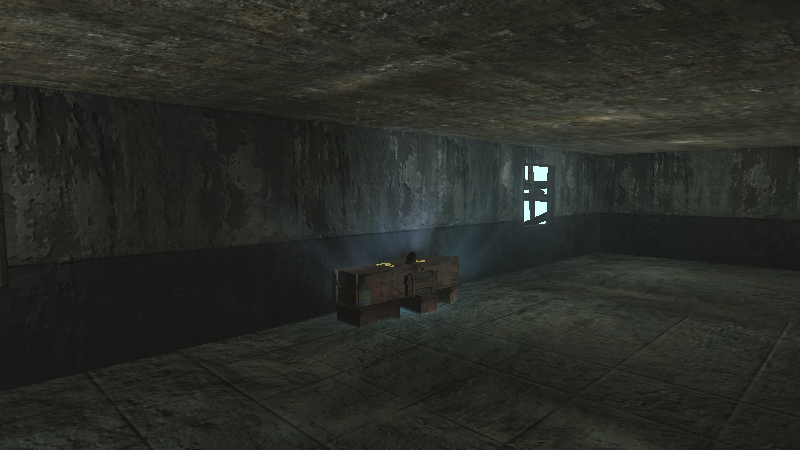

# World at War Environment Previewer

Try lights, skies, Vision presets and fog in Sniperbolt’s Zombies tutorial scene, then take the settings back to your own map or scripts. Made by [phil81334](https://github.com/phil81334). Built with JavaScript, Rust, Vite and Tauri, with a Direct3D 9 viewport.

World at War Environment Previewer is not affiliated with Treyarch, Activision or any modding community.



**Open a full-size screenshot**

[1 · Green lights](https://raw.githubusercontent.com/phil81334/waw-environment-previewer/main/images/1.png) ·
[2 · Red lights](https://raw.githubusercontent.com/phil81334/waw-environment-previewer/main/images/2.png) ·
[3 · Skybox](https://raw.githubusercontent.com/phil81334/waw-environment-previewer/main/images/3.png) ·
[4 · Blue-lit exterior](https://raw.githubusercontent.com/phil81334/waw-environment-previewer/main/images/4.png) ·
[5 · Dark fog](https://raw.githubusercontent.com/phil81334/waw-environment-previewer/main/images/5.png) ·
[6 · Pale fog](https://raw.githubusercontent.com/phil81334/waw-environment-previewer/main/images/6.png) ·
[7 · Interior fog](https://raw.githubusercontent.com/phil81334/waw-environment-previewer/main/images/7.png)

## Download and run

1. Install Call of Duty: World at War and its original Modtools in the same game folder. Baking uses the verified Modtools 1.2 versions of `cod2map.exe`, `cod2rad.exe` and `MSVCR71.dll`.
2. Under **Assets** on the latest release, download **`waw-environment-previewer.exe`**. The source ZIP is for building the app yourself. [GitHub Releases](https://github.com/phil81334/waw-environment-previewer/releases/latest)
3. Put the downloaded EXE beside **`CoDWaW.exe`** and double-click it. The tutorial map is inside the EXE. The first launch compiles the scene in AppData and captures reflections. Later launches can reuse a matching bake and recapture reflections.

Running the EXE requires no development tools. Windows needs the [WebView2 Evergreen Runtime](https://developer.microsoft.com/microsoft-edge/webview2/#download-section) and a hardware Direct3D 9 adapter with Shader Model 3 and the render-target formats used by the scene. The app tries capable adapters in order of dedicated video memory and can use integrated graphics.

## Working in the scene

| Control | When the change appears |
| --- | --- |
| **Lights** | Toggle **Show light icons in viewport** to see numbered bulbs at the authored light positions. Select the matching light and use **View selected light** to frame it. Set colour and intensity, then **Bake & capture**. An intensity of zero switches the light off. |
| **Worldspawn** | Choose an installed skybox model or edit the sun, ambient light and contrast, then bake. The skybox list is populated from the installation each time the app opens. The last completed scene stays visible while a replacement builds. |
| **Probes** | Toggle captured reflections immediately. A new bake recaptures them. |
| **Vision** and **Fog** | Change installed Vision presets, edit their preview values or adjust fog live. Find the corresponding script call under **Details & warnings → Fog request**. |
| **Entities** and **FX** | Toggle placed models, brush entities and supported initial effects live. The Entities counter shows how many placed objects are visible. Worldspawn brushes and patches, including the room itself, stay visible. Previously baked shadows and reflections stay in the scene until recaptured. |

Right-drag to look. Use WASD to fly, Q/E to move down or up, Shift to move faster and the mouse wheel to move forward or back. **Expand viewport** gives the scene the full app content area. Press Escape to restore the controls.

The previewer uses one tutorial map. It reads authored placements without running gameplay scripts. Gameplay-triggered FX and light cast by particles are outside its rendering support. Open **Details** in the app for the scene-specific limits. After changing installed materials, models, images or shaders, use **Bake & capture** to refresh the saved scene.

## Run from source

Building the app on Windows x64 needs the WebView2 runtime and the following tools.

| Tool | Windows setup |
| --- | --- |
| Node.js | Choose a Windows x64 installer for version **22.12 or later**. The installer includes npm. [Node.js downloads](https://nodejs.org/en/download) |
| Microsoft C++ Build Tools | Select **Desktop development with C++**, including the MSVC tools and Windows SDK. [Build Tools installer](https://visualstudio.microsoft.com/visual-cpp-build-tools/) |
| Rust | Run the x64 installer and choose the default MSVC toolchain. [Rust installer](https://rust-lang.org/tools/install/) |

1. Download the source ZIP from the release and extract it. Open the folder containing `package.json` in your editor. In VS Code, use **File → Open Folder**. [VS Code for Windows](https://code.visualstudio.com/download)
2. In that folder, create a folder named `.local` and a file inside it named `game-path.txt`. In File Explorer, open your game folder, click the address bar and copy the path. Paste it into the file on one line, without quotes or the `CoDWaW.exe` filename. Development builds also accept the `WAW_ROOT` environment variable.
3. Open a fresh terminal in the project folder. In VS Code, choose **Terminal → New Terminal**. Run these commands one at a time.

   ```powershell
   npm ci
   npm run dev
   ```

`npm ci` installs the locked JavaScript dependencies. The first desktop launch also downloads and compiles the Rust dependencies, so give it time. Next time, run `npm run dev` or use the play button next to **dev** in VS Code’s **NPM Scripts** panel.

| Command | Result |
| --- | --- |
| `npm run dev` | Open the desktop app with the development game path. |
| `npm run dev:web` | Open a local frontend server. Scene loading and Direct3D rendering require the desktop app. |
| `npm run build:web` | Build the frontend into `dist/`. |
| `npm run build` | Build `release/vX.Y.Z/waw-environment-previewer.exe` for the version in `package.json`. Copy it beside `CoDWaW.exe` to run it. |

Rebuilding an archived version writes the new EXE to `release/vX.Y.Z-rebuild/waw-environment-previewer.exe`.

## Project layout

| Directory | What lives here |
| --- | --- |
| [src/](src/) | The interface, camera controls, fog and Vision settings, and reflection-probe worker. |
| [src-tauri/src/](src-tauri/src/) | The Rust desktop app. `main.rs` connects the UI to the native code. `bake.rs` runs the compilers, `d3d9/` renders the scene, and `fx/` handles effect playback. |
| [scenes/](scenes/) | The active scene selector and each scene's MAP, profile and credits. |
| [scripts/](scripts/) | Development launcher and release packaging. |

## Replace the bundled scene

1. Copy `scenes/tutorial/` to a folder such as `scenes/lighting-room/`. Replace `scene.map` with your Radiant map and update `CREDITS.md`.
2. Edit `profile.json` in that folder. Give the scene its own ID, set the camera eye and target, and choose an installed sky model and Vision preset. Set the probe position and initial fog. Use `"fx": []` for a scene without a starting effect.
3. Change `scenes/active.json` to `{"folder":"lighting-room"}` and run `npm run build`. The frontend and native renderer use the same selector. Distribute the resulting EXE.

Place light entities and their aim targets in Radiant. The previewer builds the light list from the selected MAP and uses its worldspawn properties. A new scene gets its own saved settings. Keep the layout sealed for the stock compilers, use supported installed materials and models, and test one full **Bake & capture**. The fixed-scene renderer currently supports one reflection probe and up to one initial FX placement.

Application code is GPL-3.0-only. The bundled community MAP is credited separately. [Licence](LICENCE) · [Credits and third-party notices](ATTRIBUTION.md)
